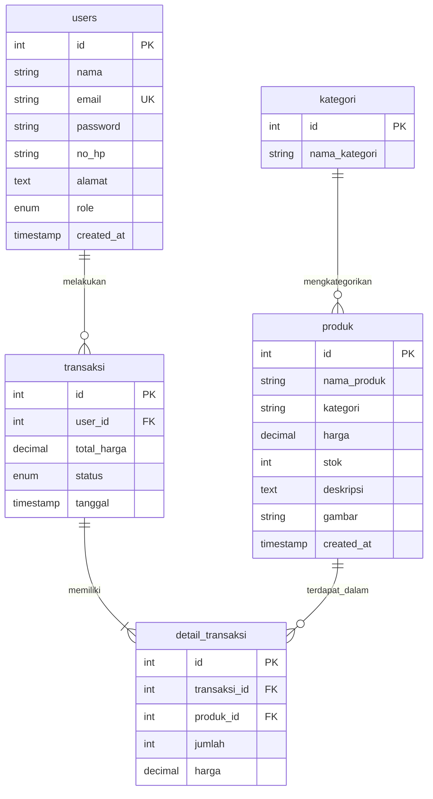

# High Value Parfume 🌸


## 📖 Deskripsi Proyek

**High Value Parfume** adalah aplikasi web e-commerce yang dirancang khusus untuk penjualan parfum premium. Aplikasi ini menyediakan platform lengkap untuk mengelola produk parfum, transaksi penjualan, manajemen pelanggan, serta sistem administrasi yang komprehensif.

Dengan tagline *"Karya Seni Aroma yang Menggoda"*, High Value Parfume menghadirkan pengalaman berbelanja parfum yang elegan dan mudah digunakan, baik untuk pelanggan maupun administrator.

---

## ✨ Fitur Utama

### 🛍️ Fitur Pelanggan
- **Katalog Produk** - Tampilan produk parfum yang menarik dan informatif
- **Keranjang Belanja** - Sistem keranjang belanja yang interaktif
- **Sistem Login/Register** - Autentikasi pengguna yang aman
- **Transaksi Pembelian** - Proses checkout yang mudah dan cepat
- **Riwayat Pembelian** - Pelacakan pesanan dan riwayat transaksi
- **Halaman About** - Informasi tentang perusahaan
- **FAQ** - Pertanyaan yang sering diajukan
- **Kontak** - Form kontak dan peta lokasi

### 👨‍💼 Fitur Admin
- **Dashboard Admin** - Ringkasan statistik dan informasi penting
- **Manajemen Produk** - CRUD (Create, Read, Update, Delete) produk parfum
- **Manajemen User** - Kelola data pengguna/pelanggan
- **Manajemen Transaksi** - Monitoring dan pengelolaan transaksi
- **Riwayat Transaksi** - Laporan transaksi lengkap
- **Kategori Produk** - Pengelompokan produk berdasarkan kategori
- **Laporan** - Generate laporan dalam format PDF dan print
- **Manajemen Keuangan** - Pencatatan piutang dan hutang
- **Ganti Password** - Keamanan akun admin

### 💼 Fitur Manajemen
- **Manajemen Bank** - Informasi rekening bank untuk pembayaran
- **Laporan Keuangan** - Laporan piutang, hutang, dan transaksi
- **Export PDF** - Cetak laporan dalam format PDF
- **Print Report** - Cetak laporan langsung

---

## 🛠️ Teknologi yang Digunakan

### Backend
- **PHP** - Server-side scripting language
- **MySQL** - Database management system
- **MySQLi** - PHP extension untuk koneksi database

### Frontend
- **HTML5** - Struktur halaman web
- **CSS3** - Styling dan layout
- **JavaScript** - Interaktivitas client-side
- **Feather Icons** - Icon library

### Library & Framework
- **Google Fonts (Poppins)** - Typography
- **Google Maps API** - Integrasi peta lokasi

---

## 📁 Struktur Direktori

```
HVFproject1/
│
├── admin/                  # Panel administrasi
│   ├── index.php          # Dashboard admin
│   ├── produk.php         # Manajemen produk
│   ├── user.php           # Manajemen user
│   ├── riwayat.php        # Riwayat transaksi
│   ├── header.php         # Header admin
│   ├── footer.php         # Footer admin
│   └── gambar/            # Upload gambar produk
│
├── manajemen/             # Panel manajemen
│   ├── index.php          # Dashboard manajemen
│   ├── transaksi.php      # Manajemen transaksi
│   ├── laporan.php        # Laporan
│   ├── laporan_pdf.php    # Export PDF
│   ├── laporan_print.php  # Print laporan
│   ├── piutang.php        # Manajemen piutang
│   ├── hutang.php         # Manajemen hutang
│   ├── bank.php           # Info bank
│   └── kategori.php       # Kategori produk
│
├── produk/                # Halaman produk
│   ├── product1.php       # Katalog produk
│   ├── proses_keranjang.php  # Proses keranjang
│   └── hapus_keranjang.php   # Hapus item keranjang
│
├── login/                 # Sistem autentikasi
│   ├── index.php          # Halaman login
│   ├── periksa_login.php  # Validasi login
│   └── logout.php         # Logout
│
├── register/              # Registrasi user
│   └── index.php          # Form registrasi
│
├── about/                 # Halaman tentang kami
│   └── about1.php         # Informasi perusahaan
│
├── FAQ/                   # Frequently Asked Questions
│   └── FAQ.php            # Halaman FAQ
│
├── payment/               # Sistem pembayaran
│   └── [file pembayaran]
│
├── struk/                 # Struk/invoice
│   └── [file struk]
│
├── home/                  # Styling homepage
│   └── index1.css         # CSS homepage
│
├── assets/                # Asset statis (5400+ files)
│   ├── css/
│   ├── js/
│   ├── images/
│   └── fonts/
│
├── library/               # Library PHP (300+ files)
│   └── [various libraries]
│
├── img/                   # Gambar umum
│   └── logo.jpg
│
├── index.php              # Halaman utama
├── koneksi.php            # Konfigurasi database
└── README.md              # Dokumentasi ini
```

---

## 🚀 Instalasi dan Konfigurasi

### Prasyarat
Pastikan sistem Anda telah terinstall:
- **XAMPP** / **WAMP** / **LAMP** (Apache, MySQL, PHP)
- **PHP** versi 7.4 atau lebih tinggi
- **MySQL** versi 5.7 atau lebih tinggi
- **Web Browser** modern (Chrome, Firefox, Edge, dll)

### Langkah Instalasi

#### 1. Clone atau Download Proyek
```bash
# Clone repository (jika menggunakan Git)
git clone <repository-url>

# Atau download dan extract file ZIP
```

#### 2. Pindahkan ke Direktori Web Server
```bash
# Untuk XAMPP (Windows)
Pindahkan folder ke: C:\xampp\htdocs\HVFproject1

# Untuk XAMPP (Linux/Mac)
Pindahkan folder ke: /opt/lampp/htdocs/HVFproject1

# Untuk WAMP
Pindahkan folder ke: C:\wamp64\www\HVFproject1
```

#### 3. Buat Database
1. Buka **phpMyAdmin** di browser: `http://localhost/phpmyadmin`
2. Buat database baru dengan nama: `hvfproject1`
3. Import file SQL (jika tersedia) atau buat tabel secara manual

#### 4. Konfigurasi Database
Edit file `koneksi.php` sesuai dengan konfigurasi database Anda:

```php
<?php 
$koneksi = mysqli_connect("localhost", "root", "", "hvfproject1");
?>
```

**Parameter:**
- `localhost` - Host database (biasanya localhost)
- `root` - Username database
- `` (kosong) - Password database (default XAMPP kosong)
- `hvfproject1` - Nama database

#### 5. Struktur Database (Contoh)

Buat tabel-tabel berikut di database `hvfproject1`:

**Tabel: users**
```sql
CREATE TABLE users (
    id INT AUTO_INCREMENT PRIMARY KEY,
    nama VARCHAR(100),
    email VARCHAR(100) UNIQUE,
    password VARCHAR(255),
    no_hp VARCHAR(20),
    alamat TEXT,
    role ENUM('admin', 'user') DEFAULT 'user',
    created_at TIMESTAMP DEFAULT CURRENT_TIMESTAMP
);
```

**Tabel: produk**
```sql
CREATE TABLE produk (
    id INT AUTO_INCREMENT PRIMARY KEY,
    nama_produk VARCHAR(200),
    kategori VARCHAR(100),
    harga DECIMAL(10,2),
    stok INT,
    deskripsi TEXT,
    gambar VARCHAR(255),
    created_at TIMESTAMP DEFAULT CURRENT_TIMESTAMP
);
```

**Tabel: transaksi**
```sql
CREATE TABLE transaksi (
    id INT AUTO_INCREMENT PRIMARY KEY,
    user_id INT,
    total_harga DECIMAL(10,2),
    status ENUM('pending', 'dibayar', 'dikirim', 'selesai') DEFAULT 'pending',
    tanggal TIMESTAMP DEFAULT CURRENT_TIMESTAMP,
    FOREIGN KEY (user_id) REFERENCES users(id)
);
```

**Tabel: detail_transaksi**
```sql
CREATE TABLE detail_transaksi (
    id INT AUTO_INCREMENT PRIMARY KEY,
    transaksi_id INT,
    produk_id INT,
    jumlah INT,
    harga DECIMAL(10,2),
    FOREIGN KEY (transaksi_id) REFERENCES transaksi(id),
    FOREIGN KEY (produk_id) REFERENCES produk(id)
);
```

**Tabel: kategori**
```sql
CREATE TABLE kategori (
    id INT AUTO_INCREMENT PRIMARY KEY,
    nama_kategori VARCHAR(100)
);
```

**Tabel: bank**
```sql
CREATE TABLE bank (
    id INT AUTO_INCREMENT PRIMARY KEY,
    nama_bank VARCHAR(100),
    no_rekening VARCHAR(50),
    atas_nama VARCHAR(100)
);
```

**Tabel: piutang**
```sql
CREATE TABLE piutang (
    id INT AUTO_INCREMENT PRIMARY KEY,
    nama_debitur VARCHAR(100),
    jumlah DECIMAL(10,2),
    tanggal DATE,
    keterangan TEXT,
    status ENUM('belum_lunas', 'lunas') DEFAULT 'belum_lunas'
);
```

**Tabel: hutang**
```sql
CREATE TABLE hutang (
    id INT AUTO_INCREMENT PRIMARY KEY,
    nama_kreditur VARCHAR(100),
    jumlah DECIMAL(10,2),
    tanggal DATE,
    keterangan TEXT,
    status ENUM('belum_lunas', 'lunas') DEFAULT 'belum_lunas'
);
```

#### 6. Jalankan Aplikasi
1. Start **Apache** dan **MySQL** di XAMPP Control Panel
2. Buka browser dan akses: `http://localhost/HVFproject1`
3. Aplikasi siap digunakan!

---

## 📱 Cara Penggunaan

### Untuk Pelanggan

#### 1. Registrasi Akun
- Klik menu **"Log in"** di navbar
- Pilih **"Register"** atau buat akun baru
- Isi form registrasi dengan data lengkap
- Submit dan login dengan akun yang telah dibuat

#### 2. Belanja Produk
- Browse katalog produk di menu **"Product"**
- Klik produk untuk melihat detail
- Tambahkan ke keranjang dengan klik tombol **"Add to Cart"**
- Atur jumlah produk yang diinginkan

#### 3. Checkout
- Klik icon keranjang untuk melihat item yang dipilih
- Review pesanan Anda
- Klik **"Checkout"** untuk melanjutkan pembayaran
- Pilih metode pembayaran
- Konfirmasi pesanan

#### 4. Riwayat Pembelian
- Login ke akun Anda
- Akses menu **"Riwayat"** untuk melihat pesanan
- Cek status pesanan Anda

### Untuk Admin

#### 1. Login Admin
- Akses: `http://localhost/HVFproject1/admin`
- Login dengan kredensial admin
- Default (sesuaikan dengan data Anda):
  - Username: `admin`
  - Password: `admin123`

#### 2. Manajemen Produk
- Klik menu **"Produk"**
- **Tambah Produk**: Klik tombol "Tambah", isi form, upload gambar
- **Edit Produk**: Klik icon edit, ubah data, simpan
- **Hapus Produk**: Klik icon hapus, konfirmasi

#### 3. Manajemen User
- Klik menu **"User"**
- Lihat daftar semua pengguna
- Edit atau hapus user sesuai kebutuhan

#### 4. Manajemen Transaksi
- Klik menu **"Riwayat"**
- Lihat semua transaksi
- Update status transaksi (pending → dibayar → dikirim → selesai)

#### 5. Generate Laporan
- Akses panel **Manajemen**
- Klik menu **"Laporan"**
- Pilih periode laporan
- Export ke PDF atau Print langsung

### Untuk Manajemen

#### 1. Login Manajemen
- Akses: `http://localhost/HVFproject1/manajemen`
- Login dengan kredensial manajemen

#### 2. Dashboard
- Lihat ringkasan transaksi
- Monitor penjualan
- Cek statistik produk

#### 3. Laporan Keuangan
- **Piutang**: Kelola piutang pelanggan
- **Hutang**: Kelola hutang perusahaan
- **Laporan**: Generate laporan lengkap

---

## 🎨 Fitur Tambahan

### Responsive Design
- Tampilan optimal di berbagai ukuran layar
- Mobile-friendly interface

### Security Features
- Session management untuk autentikasi
- Password hashing (disarankan menggunakan `password_hash()`)
- SQL injection prevention dengan prepared statements

### User Experience
- Smooth animations dan transitions
- Feather Icons untuk UI yang modern
- Google Fonts untuk typography yang elegan
- Interactive shopping cart

---

## 🔐 Keamanan

### Rekomendasi Keamanan

1. **Password Hashing**
   ```php
   // Saat registrasi
   $hashed_password = password_hash($password, PASSWORD_DEFAULT);
   
   // Saat login
   if (password_verify($input_password, $hashed_password)) {
       // Login berhasil
   }
   ```

2. **Prepared Statements**
   ```php
   $stmt = $koneksi->prepare("SELECT * FROM users WHERE email = ?");
   $stmt->bind_param("s", $email);
   $stmt->execute();
   ```

3. **Session Security**
   ```php
   session_start();
   session_regenerate_id(true); // Regenerate session ID
   ```

4. **Input Validation**
   ```php
   $input = mysqli_real_escape_string($koneksi, $_POST['input']);
   $input = htmlspecialchars($input, ENT_QUOTES, 'UTF-8');
   ```

5. **HTTPS** - Gunakan SSL certificate untuk koneksi aman

---

## 🐛 Troubleshooting

### Error: "Connection Failed"
**Solusi:**
- Pastikan MySQL service berjalan
- Cek konfigurasi di `koneksi.php`
- Verifikasi username, password, dan nama database

### Error: "Undefined index"
**Solusi:**
- Gunakan `isset()` atau `empty()` sebelum mengakses array
- Contoh: `if(isset($_POST['nama'])) { ... }`

### Gambar Produk Tidak Muncul
**Solusi:**
- Cek permission folder `admin/gambar/`
- Pastikan path gambar benar
- Verifikasi file gambar ter-upload dengan benar

### Session Tidak Berfungsi
**Solusi:**
- Pastikan `session_start()` dipanggil di awal file
- Cek konfigurasi `session.save_path` di `php.ini`
- Clear browser cookies dan cache

---

## 📊 Database Schema



---

## 🔄 Update & Maintenance

### Backup Database
```bash
# Export database
mysqldump -u root -p hvfproject1 > backup_hvfproject1.sql

# Import database
mysql -u root -p hvfproject1 < backup_hvfproject1.sql
```

### Update Aplikasi
1. Backup database dan file terlebih dahulu
2. Download versi terbaru
3. Replace file lama dengan yang baru
4. Jalankan migration script jika ada
5. Test semua fitur

---

## 👥 Tim Pengembang

**HVF WEB TEAM**
- Fakultas Sains & Teknologi UKMC
- Program Studi Informatika
- © 2022

### Kontak
- **Instagram**: [@jrycevin_11](https://www.instagram.com/jrycevin_11/)
- **Email**: [Hubungi melalui form kontak]
- **Lokasi**: Fakultas Sains & Teknologi UKMC

---

## 📄 Lisensi

Proyek ini dibuat untuk keperluan akademik dan pembelajaran.

---

## 🙏 Acknowledgments

- **Google Fonts** - Poppins font family
- **Feather Icons** - Beautiful icon set
- **Google Maps API** - Location integration
- **UKMC** - Universitas Katolik Musi Charitas

---

## 📞 Support

Jika Anda mengalami masalah atau memiliki pertanyaan:

1. Cek bagian **Troubleshooting** di atas
2. Baca **FAQ** di aplikasi
3. Hubungi tim pengembang melalui form kontak
4. Buka issue di repository (jika menggunakan Git)

---

## 🚀 Roadmap

### Fitur yang Akan Datang
- [ ] Payment gateway integration (Midtrans, etc.)
- [ ] Email notification untuk transaksi
- [ ] WhatsApp notification
- [ ] Product review & rating
- [ ] Wishlist feature
- [ ] Promo & discount system
- [ ] Multi-language support
- [ ] Mobile app (Android/iOS)
- [ ] Advanced analytics dashboard
- [ ] Inventory management system

---

## 📝 Changelog

### Version 1.0.0 (Current)
- ✅ Sistem e-commerce dasar
- ✅ Manajemen produk
- ✅ Sistem transaksi
- ✅ Panel admin & manajemen
- ✅ User authentication
- ✅ Laporan PDF & Print
- ✅ Manajemen keuangan (piutang/hutang)

---

## 💡 Tips Penggunaan

### Untuk Performa Optimal
1. Gunakan gambar produk dengan ukuran optimal (max 500KB)
2. Compress gambar sebelum upload
3. Bersihkan session dan cache secara berkala
4. Optimize database dengan indexing
5. Gunakan CDN untuk asset statis

### Best Practices
1. Backup database secara rutin (harian/mingguan)
2. Update PHP dan MySQL ke versi terbaru
3. Monitor error logs
4. Implementasi HTTPS di production
5. Gunakan environment variables untuk kredensial

---

**Selamat menggunakan High Value Parfume! 🌸✨**

*Karya Seni Aroma yang Menggoda*
# High-Value-Parfum
